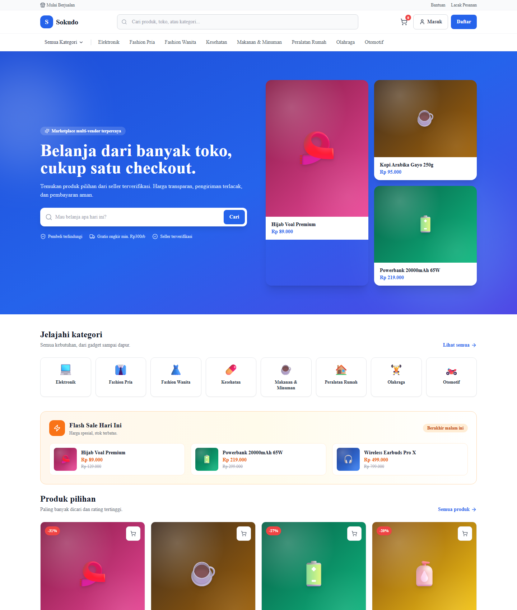
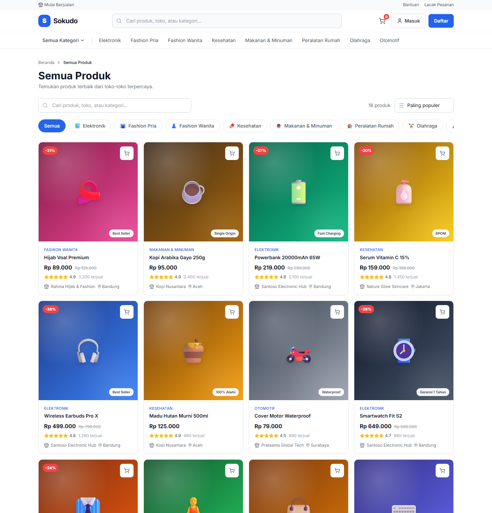
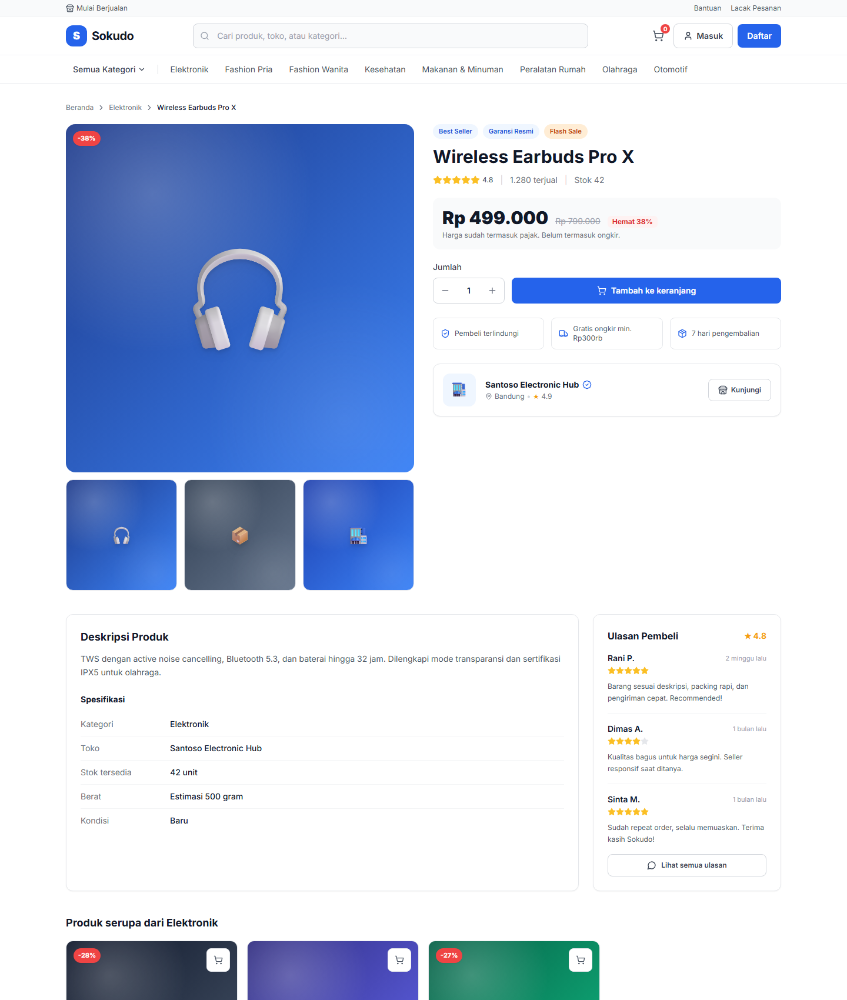
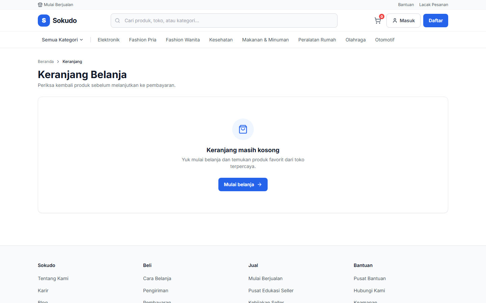
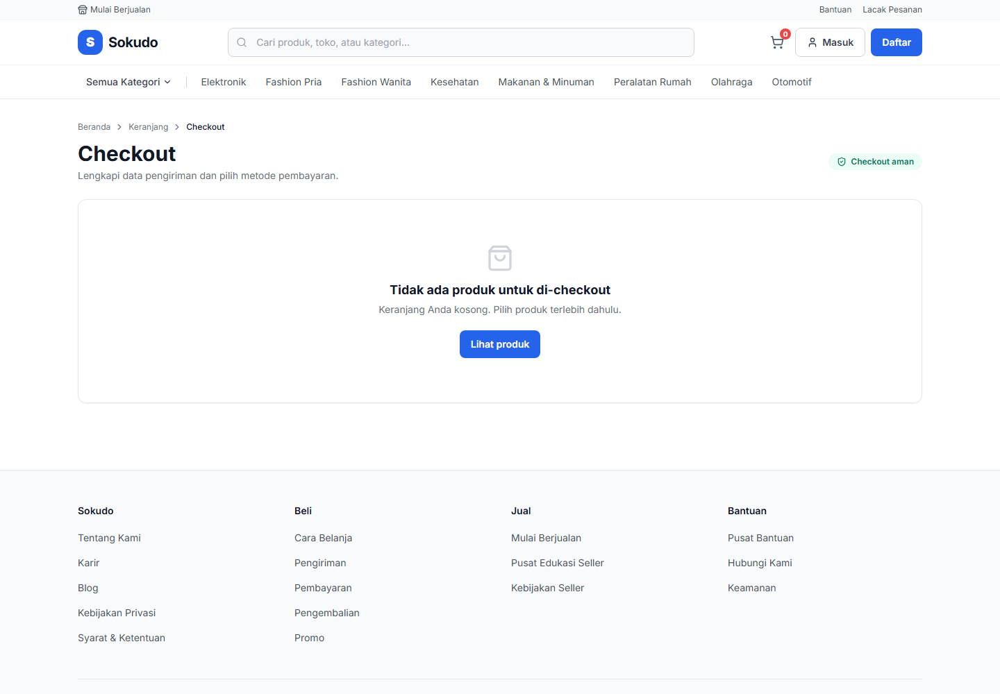
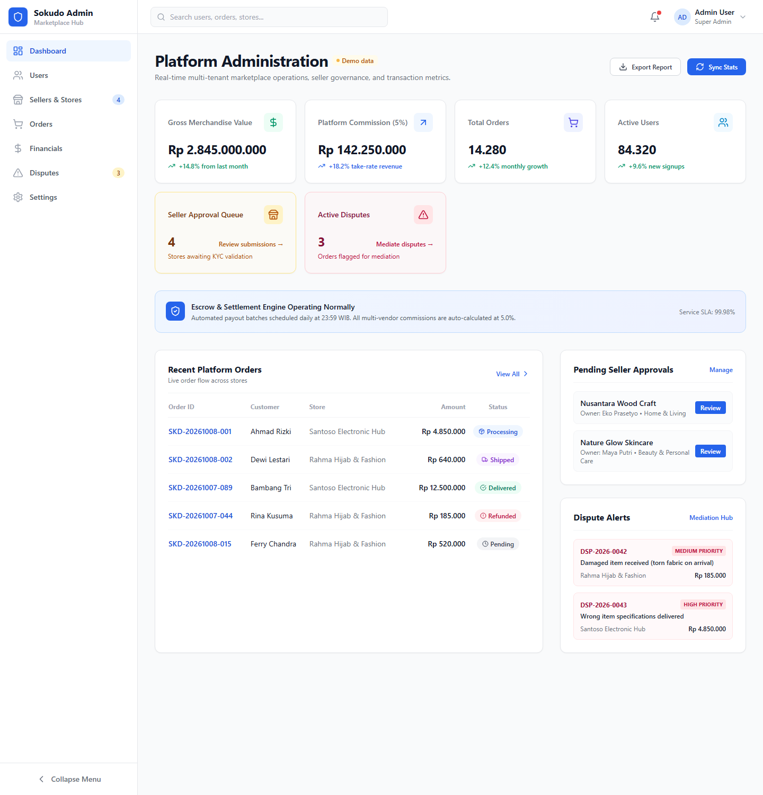
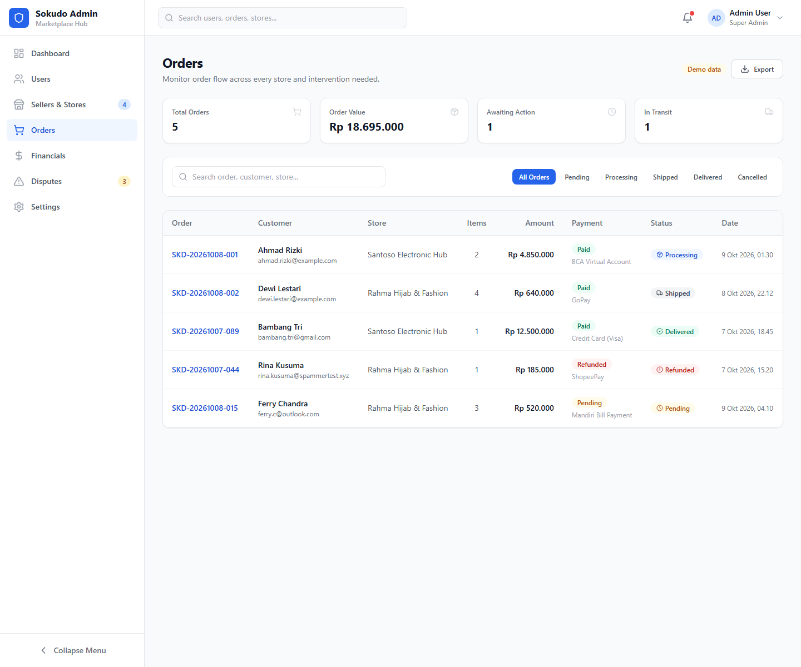

# Sokudo

Marketplace multi-vendor: storefront pembeli, panel admin platform, dan REST API dalam satu monorepo.

Sokudo memungkinkan beberapa toko (seller) menjual produk dalam satu pengalaman belanja. Pembeli dapat menjelajah katalog, mencari produk, mengelola keranjang, checkout sebagai tamu, dan melacak pesanan. Admin platform mengelola pengguna, toko, pesanan, keuangan, sengketa, dan konfigurasi platform.



---

## Daftar Isi

- [Tangkapan Layar](#tangkapan-layar)
- [Fitur](#fitur)
- [Tech Stack](#tech-stack)
- [Struktur Repository](#struktur-repository)
- [Prasyarat](#prasyarat)
- [Setup](#setup)
- [Menjalankan Aplikasi](#menjalankan-aplikasi)
- [Akun Demo](#akun-demo)
- [Environment Variables](#environment-variables)
- [API Endpoints](#api-endpoints)
- [Alur Checkout & Mode Demo](#alur-checkout--mode-demo)
- [Model Data](#model-data)
- [Deployment](#deployment)
- [Status Implementasi](#status-implementasi)

---

## Tangkapan Layar

### Storefront

| Katalog | Detail produk |
| --- | --- |
|  |  |

| Keranjang | Checkout |
| --- | --- |
|  |  |

### Panel Admin

| Dashboard | Orders |
| --- | --- |
|  |  |

---

## Fitur

### Storefront Pembeli (`apps/web`, port 3000)

- **Beranda**: hero pencarian, kategori, flash sale, produk populer, dan CTA seller.
- **Katalog** (`/products`): pencarian, filter kategori, dan urutan (populer, terbaru, harga, rating).
- **Detail produk** (`/products/[slug]`): galeri visual, harga/diskon, stok, rating, ulasan, info toko, dan produk serupa.
- **Keranjang** (`/cart`): ubah jumlah, hapus item, ringkasan belanja, gratis ongkir minimal Rp300.000, dan penyimpanan `localStorage`.
- **Checkout** (`/checkout`): data pembeli, alamat, kurir, metode pembayaran, dan pembuatan pesanan.
- **Pesanan** (`/orders`): pelacakan status berdasarkan nomor pesanan.
- **Pesanan berhasil** (`/orders/success`): nomor pesanan, total, dan status.
- **Autentikasi** (`/auth/login`, `/auth/register`): terhubung ke API saat database berjalan.
- **Halaman informasi**: Tentang Kami, Karir, Blog, Kebijakan Privasi, Syarat & Ketentuan, Pusat Bantuan, Mulai Berjualan, Hubungi Kami, dan Keamanan.
- **Halaman placeholder** untuk rute lain yang belum diimplementasikan.

### Panel Admin (`apps/admin`, port 3001)

- **Dashboard**: GMV, komisi platform, pesanan, pengguna aktif, antrean approval seller, dan ringkasan aktivitas.
- **Users**: daftar pengguna, filter role/status, ubah role, suspend/aktifkan akun.
- **Sellers & Stores**: daftar toko, status KYC, approve/reject/suspend, dan statistik toko.
- **Orders**: daftar pesanan lintas toko, filter status, pencarian, dan ringkasan nilai pesanan.
- **Financials**: GMV, komisi, payout seller, refund, dan daftar transaksi.
- **Disputes**: antrean sengketa, detail bukti, refund pembeli, atau dismiss.
- **Settings**: konfigurasi umum, komisi, pembayaran, pengiriman, dan notifikasi admin.

### API (`apps/api`, port 4000)

- Autentikasi JWT (register, login, profil).
- Katalog publik: produk, kategori, toko.
- Checkout tamu: pembuatan pesanan, pemotongan stok, dan data pembayaran.
- Endpoint admin: statistik, pengguna, toko, pesanan, dan transaksi.

---

## Tech Stack

| Layer | Teknologi |
| --- | --- |
| Storefront | Next.js 14 (App Router), React 18, TypeScript, Tailwind CSS |
| Admin Panel | Next.js 14 (App Router), React 18, TypeScript, Tailwind CSS |
| Backend | NestJS 10, TypeScript, Passport JWT, class-validator |
| Database | PostgreSQL 16 + Prisma ORM |
| Cache/Queue | Redis (disiapkan di `docker-compose.yml`) |
| Ikon | lucide-react |
| Monorepo | npm workspaces |

---

## Struktur Repository

```
SOKUDO/
├── apps/
│   ├── web/                 # Storefront pembeli (Next.js, port 3000)
│   ├── admin/               # Panel admin (Next.js, port 3001)
│   └── api/                 # REST API (NestJS, port 4000)
│       ├── prisma/
│       │   ├── schema.prisma
│       │   └── seed.ts
│       └── src/
│           ├── admin/       # Statistik & moderasi platform
│           ├── auth/        # Register, login, JWT
│           ├── catalog/     # Produk, kategori, toko
│           ├── orders/      # Checkout & pelacakan pesanan
│           └── prisma/      # Prisma service
├── packages/
│   ├── types/               # Tipe domain bersama
│   └── common/              # Utility response, currency, date
├── .github/                 # Workflow CI (build API, web, admin)
├── docs/                    # Screenshot + panduan deployment
├── docker-compose.yml       # PostgreSQL + Redis
├── package.json             # Workspace scripts
└── README.md
```

---

## Prasyarat

- Node.js 20 atau lebih baru (lihat `.nvmrc`)
- npm 9 atau lebih baru
- PostgreSQL 16 (lokal atau Docker)
- Docker Desktop (opsional, untuk menjalankan PostgreSQL/Redis)

---

## Setup

### 1. Install dependencies

```bash
npm install
```

### 2. Siapkan environment API

```bash
cp apps/api/.env.example apps/api/.env
```

Sesuaikan `DATABASE_URL` jika kredensial PostgreSQL berbeda.

### 3. Jalankan database

Dengan Docker:

```bash
docker compose up -d postgres redis
```

Tanpa Docker: buat database PostgreSQL dengan nama `marketplace_db`, user `marketplace_user`, dan password `marketplace_password` (atau ubah `DATABASE_URL`).

### 4. Migrasi & seed database

```bash
npm run prisma:generate --workspace=apps/api
npm run prisma:migrate --workspace=apps/api -- --name init
npm run prisma:seed --workspace=apps/api
```

Seed akan mengisi kategori, 7 toko, 18 produk, pesanan contoh, serta akun admin/buyer/seller.

### 5. Jalankan aplikasi

Buka tiga terminal:

```bash
# Terminal 1 — API
npm run dev:api

# Terminal 2 — Storefront
npm run dev:web

# Terminal 3 — Admin
npm run dev:admin
```

| Aplikasi | URL |
| --- | --- |
| Storefront | <http://localhost:3000> |
| Admin Panel | <http://localhost:3001> |
| API | <http://localhost:4000/api> |

---

## Akun Demo

Tersedia setelah `prisma:seed` dijalankan.

| Role | Email | Password |
| --- | --- | --- |
| Admin | `admin@sokudo.id` | `Admin123!` |
| Buyer | `buyer@sokudo.id` | `Buyer123!` |
| Seller | `budi.santoso@techstore.co.id` | `Seller123!` |

---

## Environment Variables

### API (`apps/api/.env`)

| Variabel | Default | Deskripsi |
| --- | --- | --- |
| `PORT` | `4000` | Port API |
| `NODE_ENV` | `development` | Mode runtime |
| `DATABASE_URL` | — | Koneksi PostgreSQL |
| `JWT_SECRET` | — | Secret penandatangan JWT |
| `JWT_EXPIRES_IN` | `7d` | Masa berlaku token |
| `REDIS_HOST` | `localhost` | Host Redis |
| `REDIS_PORT` | `6379` | Port Redis |

### Frontend (`apps/web`, `apps/admin`)

| Variabel | Default | Deskripsi |
| --- | --- | --- |
| `NEXT_PUBLIC_API_URL` | `http://localhost:4000/api` | Base URL API dari browser |
| `API_URL` | `http://localhost:4000/api` | Base URL API dari server |

Nilai default sudah cukup untuk pengembangan lokal. Contoh variabel tersedia di `apps/api/.env.example`, `apps/web/.env.example`, dan `apps/admin/.env.example`. Salin ke `.env` / `.env.local` bila ingin mengubahnya — file `.env` asli tidak ikut ter-commit.

---

## API Endpoints

Semua endpoint diawali `/api`.

### Auth

| Method | Endpoint | Deskripsi |
| --- | --- | --- |
| `POST` | `/auth/register` | Registrasi pengguna |
| `POST` | `/auth/login` | Login, mengembalikan access token |
| `GET` | `/auth/me` | Profil pengguna (butuh token) |

### Catalog

| Method | Endpoint | Deskripsi |
| --- | --- | --- |
| `GET` | `/categories` | Daftar kategori |
| `GET` | `/stores` | Daftar toko |
| `GET` | `/products` | Daftar produk (`search`, `category`, `sort`, `page`, `limit`) |
| `GET` | `/products/:slug` | Detail produk |

### Orders

| Method | Endpoint | Deskripsi |
| --- | --- | --- |
| `POST` | `/orders` | Buat pesanan (guest checkout) |
| `GET` | `/orders/:orderNumber` | Lacak pesanan |

Contoh body `POST /orders`:

```json
{
  "customer": {
    "name": "Ahmad Rizki",
    "email": "ahmad@example.com",
    "phone": "081234567890"
  },
  "address": {
    "recipientName": "Ahmad Rizki",
    "phoneNumber": "081234567890",
    "street": "Jl. Kebayoran Baru No. 12",
    "city": "Jakarta Selatan",
    "province": "DKI Jakarta",
    "postalCode": "12110"
  },
  "items": [{ "productId": "<uuid>", "quantity": 1 }],
  "courier": "jne-reg",
  "paymentMethod": "transfer"
}
```

### Admin

| Method | Endpoint | Deskripsi |
| --- | --- | --- |
| `GET` | `/admin/stats` | Statistik platform |
| `GET` | `/admin/users` | Daftar pengguna |
| `GET` | `/admin/stores` | Daftar toko & performa |
| `GET` | `/admin/orders` | Daftar pesanan |
| `GET` | `/admin/transactions` | Daftar transaksi |

> Endpoint admin saat ini belum dilindungi guard role. Tambahkan `JwtAuthGuard` + `RolesGuard` sebelum dipakai di produksi.

---

## Alur Checkout & Mode Demo

1. Pembeli menambah produk ke keranjang (disimpan di `localStorage`).
2. Checkout mengirim `POST /orders`.
3. API memvalidasi stok, menghitung subtotal, ongkir (gratis mulai Rp300.000, selain itu Rp15.000), membuat user tamu, alamat, pesanan, item, dan pembayaran dalam satu transaksi Prisma.
4. Halaman sukses menampilkan nomor pesanan.

Bila API atau database belum berjalan, storefront dan admin otomatis memakai data demo lokal:

- Katalog demo: `apps/web/src/lib/catalog.ts`
- Checkout demo: nomor pesanan `SKD-DEMO-xxxx` dan banner peringatan di halaman sukses.
- Admin demo: `apps/admin/src/data/mock-data.ts` dengan badge **Demo data**.

Jadi UI tetap bisa dijalankan tanpa PostgreSQL, tetapi data pesanan tidak tersimpan permanen.

---

## Model Data

Model Prisma utama (lihat `apps/api/prisma/schema.prisma`):

- `User`, `Address` — akun dan alamat.
- `Seller` — toko milik user dengan role `SELLER`.
- `Category`, `Product`, `ProductImage`, `ProductVariant`, `Review`.
- `Cart`, `CartItem`.
- `Order`, `OrderItem`, `Payment`, `Shipment`.
- `Review` menyimpan rating dan ulasan per produk.

Total 14 tabel. Belum ada model `LedgerEntry`; ringkasan keuangan admin dihitung dari `Payment` dan `Order`.

Status penting: `Role`, `SellerStatus`, `ProductStatus`, `OrderStatus`, `PaymentStatus`, `ShipmentStatus`.

---

## Deployment

Aplikasi ini butuh tiga service: storefront + admin di **Vercel**, API di **Render/Railway**, dan PostgreSQL di **Neon/Supabase**. GitHub Pages tidak bisa dipakai karena hanya menyajikan file statis, sedangkan Next.js di proyek ini memerlukan server.

Panduan langkah demi langkah (root directory, build command, environment variables, migrasi, dan checklist) ada di [`docs/DEPLOYMENT.md`](docs/DEPLOYMENT.md).

Konfigurasi Vercel sudah disiapkan di:

- `apps/web/vercel.json`
- `apps/admin/vercel.json`

Keduanya memakai `installCommand`/`buildCommand` yang menunjuk ke root monorepo, jadi **Root Directory** di Vercel harus diisi `apps/web` atau `apps/admin`.

---

## Status Implementasi

| Area | Status |
| --- | --- |
| Storefront (home, katalog, detail, cart, checkout, orders, auth) | Selesai |
| Panel admin (dashboard, users, sellers, orders, financials, disputes, settings) | Selesai |
| API katalog, pesanan, admin | Selesai |
| Prisma schema + migrasi + seed | Selesai |
| Integrasi API dengan fallback demo | Selesai |
| Seller dashboard | Belum |
| Chat, notifikasi, voucher, wishlist | Belum |
| Payment gateway & webhook nyata | Belum (masih simulasi) |
| Guard role untuk endpoint admin | Belum |

### Build & verifikasi

```bash
npm run build --workspace=apps/api
npm run build --workspace=apps/web
npm run build --workspace=apps/admin
```

Ketiga workspace lulus TypeScript build. Menjalankan alur database end-to-end memerlukan PostgreSQL aktif.
